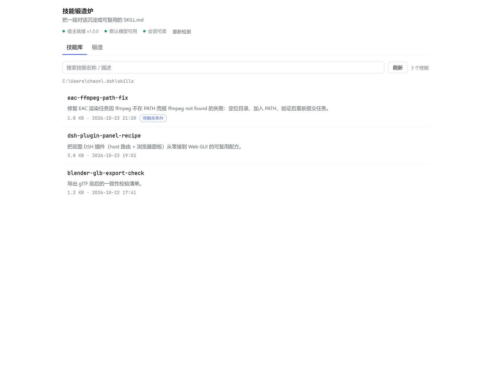
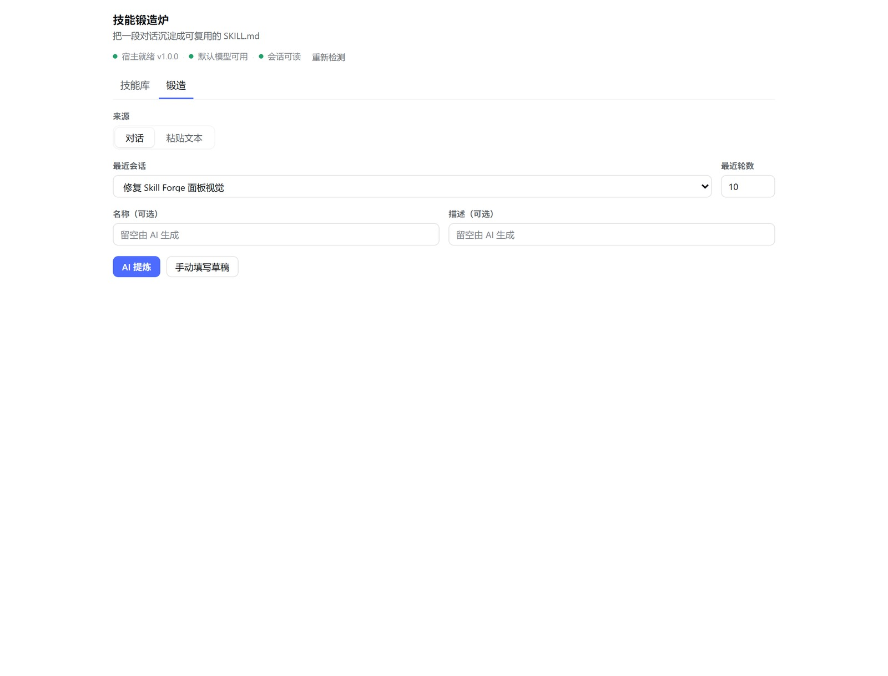
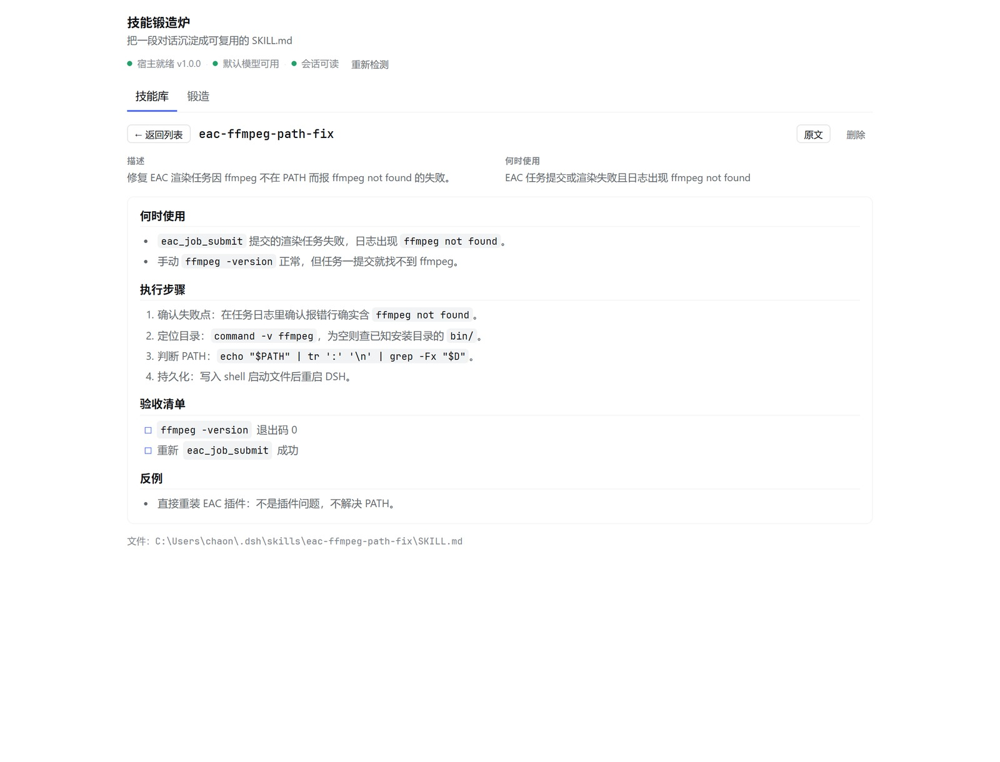
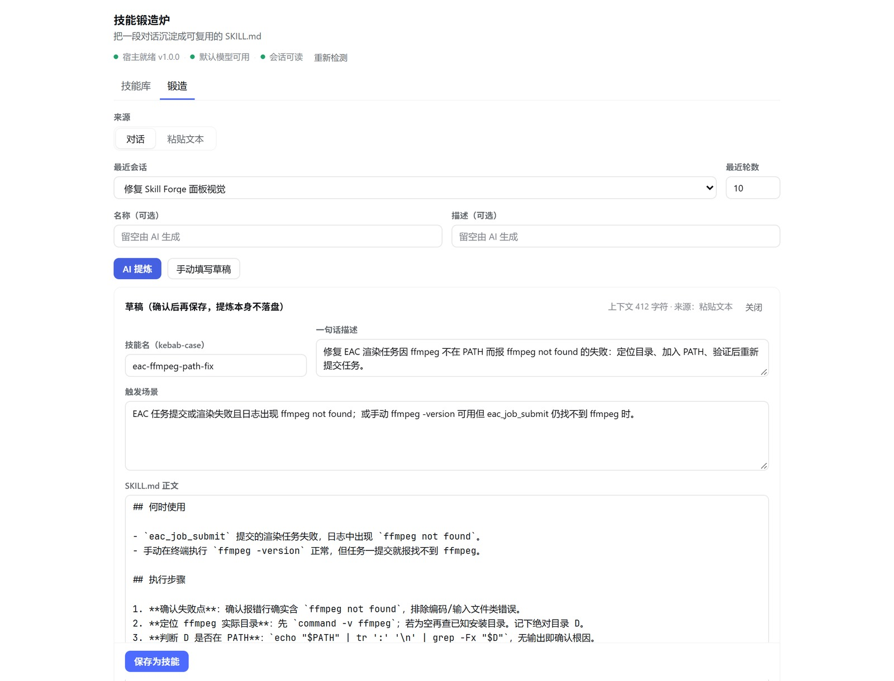
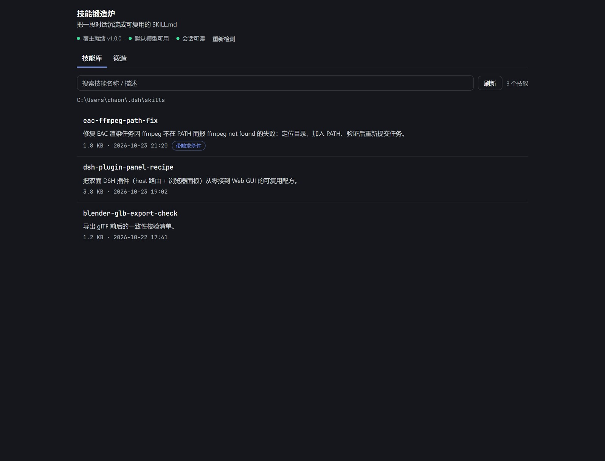

# 技能锻造炉 · Skill Forge

**把一段对话沉淀成可复用的 `SKILL.md`，让下一次相似问题直接命中技能，而不是重新推一遍。**

DeepSeek Harness（DSH）插件。提供 4 个模型工具 + 一个 Web GUI 面板（侧边栏「技能锻造炉」）。

<p align="center">
  
</p>

---

## 它解决什么问题

同一个问题问第二遍时，模型是在重新推导：重新读上下文、重新试错、重新组织答案。这些 token 花得一模一样，成果却留在对话里，下次还得再来。

Skill Forge 做一件事：**把一个已经解决的流程，在对话结束时压缩成一个技能文件**。之后 DSH 的技能目录会在相关的请求上命中它，模型加载几十行指令，而不是重新思考几百行过程。

技能写在 `~/.dsh/skills/<name>/SKILL.md`，是 DSH 官方 skill 目录，任何支持 skill 的 preset 都能用。

---

## 两条使用路径

### 1. 让 Agent 自己沉淀（推荐，零配置）

对模型说一句自然语言即可，它会调用工具链：

> 把刚才这套 ffmpeg 排错流程存成 skill

模型依次调用：

| 工具 | 作用 |
|---|---|
| `skill_forge_context` | 取当前会话（或指定会话）最近 N 轮的有界摘要，默认 10 轮 / 16000 字符，超长保留最新尾部 |
| `skill_forge_save` | 写 `~/.dsh/skills/<name>/SKILL.md`；同名默认拒绝，覆盖时留 `.bak` |
| `skill_forge_list` | 列出本插件写过的技能（含路径、大小、时间） |
| `skill_forge_delete` | 移入 `.trash` 可恢复；**只允许删本插件写的技能** |

写入后技能目录会热刷新，本会话内即可被 `skill` 工具加载。

### 2. 在面板里手动锻造（Web GUI）

侧边栏底部、任务看板下方多一个图标，点开是两页签：

- **技能库** — 搜索 / 点行预览 / 删除（移入 `.trash`）。预览支持 Markdown 渲染与「原文」切换。
- **锻造** — 选一个最近会话，或直接粘贴文本；可留空名称/描述让 AI 生成；「AI 提炼」产出草稿 → 人工确认 → 保存。

<p align="center">
  
</p>

AI 提炼需要宿主同时具备 `llm` 与 `agentDefaultModel` 服务；不可用时接口返回 **503 `llm-unavailable`**，面板会提示改走路径 1，或手动填写草稿直接保存。

---

## 安装

### 方式 A：从 npm（发布后可用）

```sh
dsh plugin --profile web add dsh-skill-forge
```

### 方式 B：从 GitHub 本地安装

```sh
git clone https://github.com/chaonimadesazhi/dsh-skill-forge.git
dsh plugin --profile web add link:./dsh-skill-forge
```

### 方式 C：桌面客户端

桌面端的 `desktop` profile 由 Electron 应用独占管理，CLI 会拒绝写入（`profile "desktop" is managed exclusively by the Electron application`）。

请用桌面端界面：**设置 → 插件 → 安装本地目录**，指向克隆下来的目录。

安装后重启 DSH；侧边栏出现「技能锻造炉」即成功。若没有出现，检查 `dsh.client` 是否被 profile 的 bundle 列表收录。

---

## 配置

在 profile 的 `cordis.patch.yml` 里改 `skill-forge` 行：

```yaml
- id: skill-forge
  name: dsh-skill-forge
  config:
    maxCaptureChars: 20000   # 面板「AI 提炼」单次最多吞多少字符上下文
    toolCaptureChars: 16000  # skill_forge_context 默认返回上限
```

---

## 生成的技能长什么样

```markdown
---
name: eac-ffmpeg-path-fix
description: "修复 EAC 渲染任务因 ffmpeg 不在 PATH 而报 ffmpeg not found 的失败。"
whenToUse: "EAC 任务提交或渲染失败且日志出现 ffmpeg not found"
metadata:
  forge: "skill-forge"
  version: 1
---

## 何时使用
...
## 执行步骤
...
## 验收清单
...
## 反例
...
```

`metadata.forge` 是本插件的所有权标记：`skill_forge_list` 默认只列带这个标记的技能，`skill_forge_delete` 也只肯删带这个标记的技能 —— **不会动你手写或别的插件装的技能**。

---

## 安全边界

- HTTP 路由仅接受 **loopback + same-origin** 请求，跨站/局域网一律 403；请求体上限 1 MiB。
- 只写 `~/.dsh/skills`，不碰 DSH 安装目录、不改 profile 的 `package.json` / `cordis.patch.yml`。
- 不向 session log 追加事件；会话内容通过 `sessionQuery` 只读获取。
- 提炼过程不落盘，只有你按下「保存」才写文件。覆盖前会二次确认并保留 `.bak`。

---

## 已知限制

- 技能目录热刷新依赖 DSH 的文件监听，通常即时，但不承诺「秒级一定命中」。
- 「AI 提炼」依赖宿主默认模型可用；无模型时只能用路径 1 或手动草稿。
- 技能名必须是 kebab-case（小写字母/数字/连字符），这是 DSH 官方 skill 语法。
- 只管理 `~/.dsh/skills`，不支持项目级 `.dsh/skills`。
- 面板按 880px 最大宽度居中，超宽窗口下两侧留白较多。

---

## 开发与自检

仓库是纯 ESM、无构建、无运行时依赖（只用 `node:` 内置模块 + 浏览器侧 `react`）。

```sh
node --check index.js
node --check client.js
```

发布前在本地做过两套检查：结构一致性 61 项、功能行为 73 项（用临时 `DSH_HOME`，不触碰真实技能）。详见 [docs/维护者手册.md](docs/维护者手册.md)。

---

## 截图

| 预览（Markdown 渲染） | 草稿确认 |
|---|---|
|  |  |

深色主题：

<p align="center">
  
</p>

---

## License

[MIT](LICENSE)

---

[English](README.en.md) | 中文
